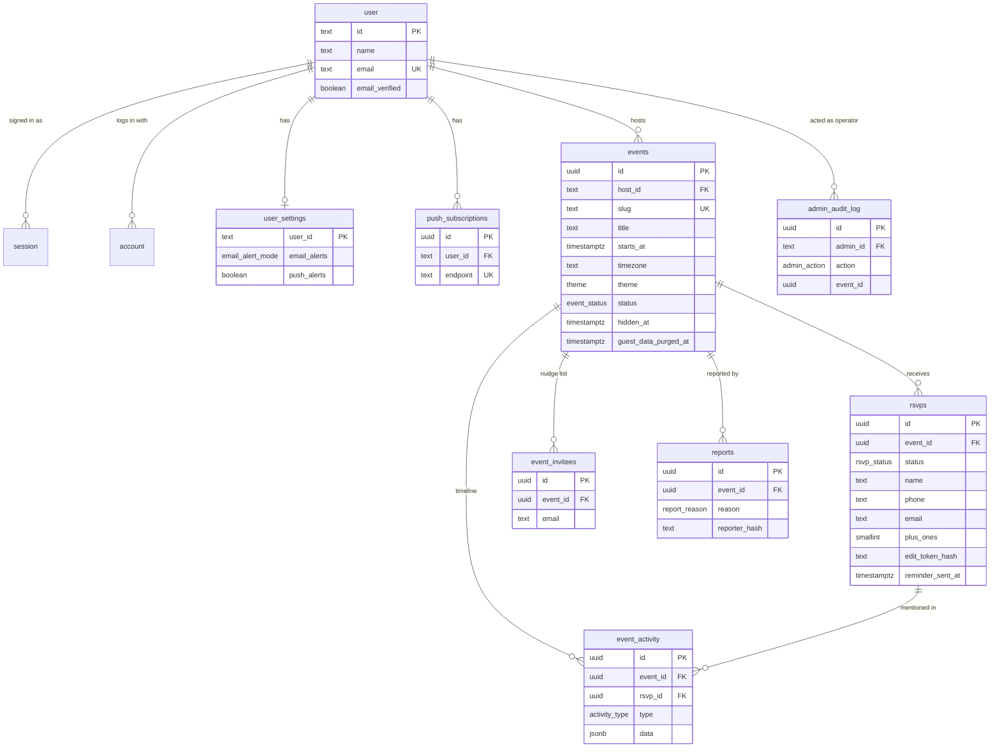

# Data model

Everything lives in one PostgreSQL 18 database. The schema is defined with Drizzle in `src/db/schema/`:

- `auth.ts`: the four tables Better Auth needs. Field names must match Better Auth's own schema.
- `app.ts`: everything else.

Column names are `snake_case` in the database and `camelCase` in code (`casing: "snake_case"` in `drizzle.config.ts`). Application ids are `uuidv7()`, so they sort by creation time. Better Auth generates its own text ids. All timestamps are `timestamptz`, stored in UTC.

pg-boss keeps its job tables in a separate schema, `pgboss`, which it manages itself.

## Diagram

Three tables stand alone, with no foreign keys: `rate_limits`, `email_suppressions` and `verification`.

## Tables

### `user`, `session`, `account`, `verification`

Better Auth's tables. `user` is a host; guests never get a row. `session` holds one row per signed-in device, with the token, expiry, IP address and user agent. `account` holds the password hash for email sign-in, or the provider link and tokens for Google. `verification` holds short-lived tokens for confirming an email, resetting a password and changing email.

Deleting a `user` cascades to their sessions, accounts, settings, push subscriptions and events.

### `user_settings`

One optional row per host: `email_alerts` (`instant`, `daily` or `off`) and `push_alerts`. A host without a row gets the defaults (`instant`, push on).

### `events`

One row per event. The columns fall into groups:

| Group | Columns |
|---|---|
| Identity | `id`, `host_id`, `slug` (unique, lower-case; the public link), `title`, `description`, `host_name` |
| When | `starts_at`, `ends_at` (optional), `timezone` (IANA name the host planned in) |
| Where | `location_type` (`physical`, `online`, `tbd`), `location_name`, `location_address`, `online_url` |
| Look | `theme` (one of ten), `cover_image_key` (a key in file storage) |
| State | `status` (`active`, `cancelled`), `cancel_message`, `rsvp_deadline`, `rsvp_closed` |
| Guest form | `guest_list_visibility` (`hidden`, `count`, `names`), `phone_mode` (`required`, `optional`, `hidden`), `allow_message`, `allow_plus_ones`, `max_plus_ones`, `custom_questions` (JSON array, up to 3) |
| Email | `update_emails_sent` (capped at 5), `reminder_enabled`, `nudge_sent_at` (set once; a nudge goes out once per event), `last_notable_update_at` and `last_notable_update_summary` (drive the "Updated" banner) |
| Moderation | `report_count`, `hidden_at` |
| Privacy | `guest_data_purged_at` |

An event has exactly one host. There is no capacity column: the only cap is the platform limit of 200 responses.

Indexes: unique on `slug`; `(host_id, starts_at)` for the host's list; `starts_at` for the reminder sweep; `(starts_at, guest_data_purged_at)` for the purge.

### `rsvps`

One row per guest response: `status` (`going`, `maybe`, `not_going`), `name`, optional `phone`, `email` and `message`, `plus_ones`, and `answers` (a JSON object keyed by custom-question id).

`edit_token_hash` is the SHA-256 of the secret that lets the guest edit the response ([security.md](security.md#guest-credentials)). After the 90-day purge it holds the literal string `purged`, and `phone` and `email` are null. `reminder_sent_at` guarantees one reminder per guest.

### `event_invitees`

Addresses a host pasted to be nudged, for people who haven't responded. Lower-cased, unique per event, at most 100 per event. Deleted by the 90-day purge.

### `event_activity`

The host's timeline. `type` is one of `event_created`, `event_updated`, `event_cancelled`, `rsvp_created`, `rsvp_updated`, `rsvp_removed`, `update_email_sent`, `nudge_sent`. `data` is a small JSON object: a guest name, a status change (`from`, `to`), the list of changed fields, or the number of people nudged (never their addresses).

`rsvp_id` becomes null when the response is deleted, so the entry survives. When a guest deletes their own response, `guestName` is removed from every entry that pointed at it.

### `reports`

One row per report: reason, optional details, and `reporter_hash`, a keyed hash of the reporter's network. A unique index on `(event_id, reporter_hash)` stops the same network reporting an event twice. Restoring an event deletes its reports.

### `push_subscriptions`

Web Push subscriptions for hosts: the browser's endpoint (unique) and two keys. A subscription the push service reports as gone is deleted the next time an alert is sent.

### `rate_limits`

Fixed-window counters for every limit that isn't a simple row count: `key`, `count`, `expires_at`. The key includes the window's start, so a new window is a new row. Expired rows are deleted hourly. See [ADR 0015](adr/0015-rate-limits-and-client-ip.md).

### `email_suppressions`

Addresses that must not be emailed: the lower-cased `email` is the primary key, with a `reason` of `unsubscribed`, `bounced` or `complained`. It has no link to any other table on purpose, so it outlives the purge and account deletion. See [email.md](email.md#categories-unsubscribes-and-the-suppression-list).

### `admin_audit_log`

What operators did: `admin_id` (set to null if that account is later deleted), `admin_email`, `action` (`restore_event` or `delete_event`), and a copy of the event's id, title and slug. `event_id` is deliberately not a foreign key, because the event may be gone.

## What deleting does

| Deleted | Also removed (cascade) | Left behind |
|---|---|---|
| A host account | Sessions, accounts, settings, push subscriptions, events and everything under them | Audit entries (operator id nulled), suppressions |
| An event | Responses, invitees, activity, reports | Audit entries about it; the cover file is removed by the action, not the database |
| A response | Nothing | Activity entries, with `rsvp_id` null |

## JSON columns

Their shapes are TypeScript types in `src/db/schema/app.ts`:

- `CustomQuestion`: `{ id, label, type: "text" | "choice", required, choices? }`
- `CustomAnswers`: `{ [questionId]: answer }`
- `ActivityData`: `{ guestName?, from?, to?, changes?, bySelf?, recipients? }`

## Changing the schema

1. Edit `src/db/schema/*`.
2. Run `pnpm run db:generate`. It writes a numbered SQL file and a snapshot into `drizzle/`.
3. Commit both. Never edit a migration that is already committed: databases that applied it will not run it again. CI fails if the schema and `drizzle/` disagree.

Migrations are applied when the server starts ([ADR 0016](adr/0016-migrations-on-boot.md)). There are six so far, `0000` to `0005`.
